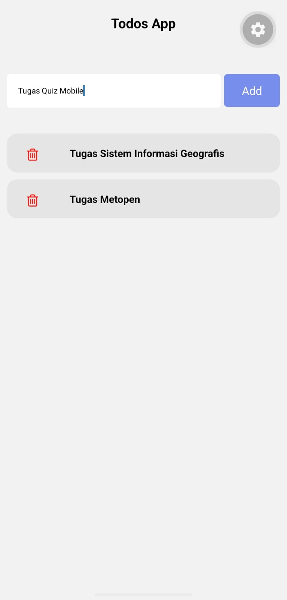
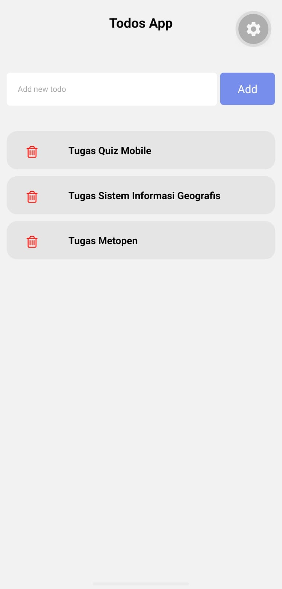

# CRUD To Do List — React Native

Aplikasi **To Do List** dengan operasi **CRUD** (Create, Read, Update, Delete) yang dibuat dengan React Native.

## Deskripsi

Aplikasi untuk mencatat dan mengelola daftar tugas harian. Pengguna dapat menambah tugas baru, melihat daftar tugas, mengubah isi tugas, dan menghapus tugas yang sudah tidak diperlukan.

Aplikasi ini dibuat untuk memahami konsep operasi CRUD pada aplikasi mobile: pengelolaan state, input pengguna, dan penampilan daftar data.

## Fitur CRUD

| Operasi | Fungsi | Status |
|---------|--------|--------|
| **Create** | Menambah tugas baru | [x] |
| **Read** | Menampilkan daftar tugas | [x] |
| **Update** | Mengubah isi atau status tugas (misalnya selesai) | [x] |
| **Delete** | Menghapus tugas | [x] |

## Cara Penggunaan

1. **Tambah tugas:** ketik tugas pada kolom input, lalu tekan tombol tambah.
2. **Lihat tugas:** semua tugas tampil dalam daftar di layar utama.
3. **Ubah tugas:** tekan tugas.
4. **Hapus tugas:** tekan tombol Hapus.

## Tampilan Aplikasi

| Daftar tugas | Tambah tugas | Ubah tugas |
|--------------|--------------|--------------------|
|  |  |  |

## Teknologi

- React Native ([Expo / CLI])
- TypeScript
- Penyimpanan data: [state saja / AsyncStorage / SQLite / API]

## Cara Menjalankan

Prasyarat: Node.js, serta emulator Android atau aplikasi **Expo Go** di HP.

```bash
git clone https://github.com/Ramaadhan/MobileTodosApp/tree/main/TodosApp
cd TodosApp
npm install
npx expo start
```

> Jika proyek memakai React Native CLI, ganti perintah terakhir dengan `npm start`, lalu `npm run android` di terminal kedua.

## Struktur Proyek

```
.
├── src/app/          # kode aplikasi
├── assets/
├── screenshots/      # tangkapan layar untuk README
├── package.json
└── README.md
```

## Catatan

Dibuat untuk keperluan tugas perkuliahan (Pemrograman Mobile, Tugas Sesi #6).
